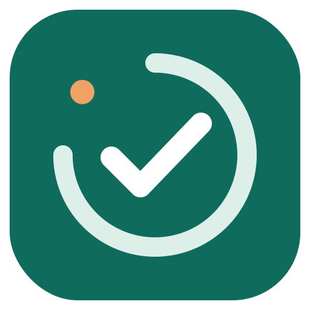
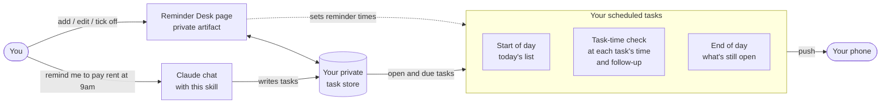

<p align="center">
  
</p>

<h1 align="center">Reminder Desk</h1>

<p align="center">A Claude skill that keeps nudging you about a task until you tick it off.</p>

## Why I built this?

I wanted an AI assistant that keeps me on top of my daily to-dos, and I looked at Grok Bot and OpenAI Dots for that. Both are behind a paywall. I already pay for Claude, so instead of paying for another subscription I built my own reminder agent on top of it.

## What it does

You add a task with a date and time. From that day on, until you mark it done or delete it, you get push notifications on your phone:

| When | Push | Example |
|---|---|---|
| Start of day (default 9:30 AM) | One rundown of today's tasks | 📋 Today: Pay car EMI (1:00 PM) |
| The task's time, every day | Due now | ⏰ Due now (1:00 PM): Pay car EMI |
| *N* hours later (default 1) | Follow-up | 🔁 Still open (due 1:00 PM): Pay car EMI. Done yet? |
| End of day (default 10:30 PM) | One summary of everything still open | 🌙 Still open: Pay car EMI (+1 more). Make it first thing tomorrow. |

Ticking a task off stops all its reminders. Tasks that slip past their day move to **Carried over** and keep reminding you daily, with a "(day N)" counter.

## How it works



The skill sets up four pieces on **your own** Claude account:

1. **The Reminder Desk page.** A private artifact where you add, edit, tick off and delete tasks, and change settings. Your tasks are stored in your private space on that page; nobody else can read them.
2. **A start-of-day scheduled task.** It runs at your start-of-day time and sends one push listing today's tasks.
3. **A task-check scheduled task.** It runs only in the hours of your tasks' times and their follow-up times (the page trims its schedule whenever you add, edit, tick off or delete a task). It sends a push for each reminder that is due and records what it sent so you never get the same reminder twice. Tick a task off at 11:15 and its 12:00 follow-up run disappears.
4. **An end-of-day scheduled task.** It runs at your end-of-day time and sends one push listing every task still open.

### Timezones

Times use your device's timezone. Each task keeps the zone it was created in, so "1:00 PM" set in New York fires at 1 PM New York time every day, including across daylight-saving changes.

### Settings (on the page)

- **Start-of-day reminder**: any time. Default 9:30 AM.
- **Remind again after**: 1 to 12 hours. Default 1.
- **End-of-day reminder**: any time. Default 10:30 PM.
- **24-hour format**: off by default (2:00 PM); on shows 14:00. Pushes use the same format.
- **Theme**: Light, Dark or System, from the switch at the top of the page.

Saving a new start-of-day or end-of-day time moves that scheduled task. The page asks once for permission to use Claude Code Remote to do this.

## Install

**Claude Code** (or any Claude app that supports plugin marketplaces):

```
/plugin marketplace add nishkohli96/reminder-desk
/plugin install reminder-desk@reminder-desk
```

**Claude app, from a zip:** download `reminder-desk-plugin-v<version>.zip` from the [latest release](https://github.com/nishkohli96/reminder-desk/releases/latest), then in Claude go to Customize > Plugins > Add > **Upload plugin** and choose the zip. Don't unzip it first.

After a plugin install, setup starts on its own the next time you open a session in Claude Code or Cowork.

In claude.ai chat, plugin hooks don't run, so start it yourself: open a new chat and say:

> Set up my to-do reminders

or run `/reminder-desk:setup` in Claude Code or Cowork.

Claude publishes your page, creates the three scheduled tasks in your timezone, links them, and tells you when it's ready. Running it again won't create duplicates; it reuses your existing page and reminders.

The setup needs Claude's artifact and scheduled-task tools, which the Claude app (web, desktop, mobile) provides.

### Requirements

**Requires a paid Claude plan**: scheduled tasks are not available on the free tier. Your plan needs:
- artifacts that can save data
- scheduled tasks
- the Claude Code Remote connector, which the page uses to move reminder times and keep the task-check schedule trimmed
- push notifications enabled in the Claude mobile app

## Using it from chat

Once set up, you can manage tasks without opening the page:

| Say | What happens |
|---|---|
| "Remind me to renew insurance on 25 Oct at 11am" | Adds a task |
| "Mark Pay car EMI as done" | Ticks it off; reminders stop |
| "Move the dentist reminder to Friday 6pm" | Reschedules and resets its reminders |
| "Follow up 2 hours after instead" | Changes the follow-up gap |
| "Send my end-of-day nudge at 9pm" | Moves the end-of-day reminder |
| "Update Reminder Desk" | Checks for a new version and upgrades, keeping your tasks |

## Add it to your phone's home screen

Open Reminder Desk in one tap instead of finding it inside Claude each time.

**iPhone (Safari)**
1. Open your Reminder Desk link in Safari. Copy it from the page's share/copy link in Claude, or from your gallery at [claude.ai/code/artifacts](https://claude.ai/code/artifacts).
2. Sign in to claude.ai if asked. The page needs your sign-in to load and save tasks.
3. Tap **Share** > **Add to Home Screen** > **Add**.

**Android (Chrome)**
1. Open the same link in Chrome and sign in.
2. Tap **⋮** > **Add to Home screen** (or **Install**) > **Add**.

The shortcut opens the page in your browser, not the Claude app, and the icon may be a generic one. Reminders still arrive as Claude app notifications.

## Good to know

- Scheduled tasks can't run more often than once an hour. If all your tasks share the same minute (say, all on the hour), reminders arrive within a minute or two of the task time; otherwise the check runs on the hour, so a reminder can be up to 59 minutes late. The schedule is updated from the page (or chat) when tasks change; tasks changed any other way keep the previous schedule until the next change.
- Deleting a task asks you to confirm first, on the page and in chat.
- Everything runs on your account.

## Update

### Why updating takes two steps

Reminder Desk has two parts, and they update separately:

| Part | Where it lives | How it updates |
|---|---|---|
| **Plugin files**: the skills, the page template and the reminder instructions | Installed with the plugin | A plugin update: auto-update or the `/plugin` commands in Claude Code, Customize > Plugins in the Claude app |
| **Your setup**: your Reminder Desk page and your three scheduled tasks | Your Claude account | Saying "Update Reminder Desk" |

Setup copies the page template and the reminder instructions onto your account. A plugin update replaces the plugin files but never touches those copies, so your page and reminders keep running the version they were set up with. They keep working, but without the fixes and features that live in the page or the reminders, until you run "Update Reminder Desk". Changes that only affect the skills, such as how Claude adds a task from chat, apply as soon as the plugin updates.

Keeping the two apart is deliberate: nothing on your account changes behind your back, and the update step can check that your tasks are untouched before it reports success.

### Updating

Say **"Update Reminder Desk"**, or run `/reminder-desk:update` in Claude Code or Cowork. It:

1. Compares your installed version with the latest release.
2. Updates the plugin if a newer version exists. In Claude Code it runs the update for you; then run `/reload-plugins` and ask again. In the Claude app, update it from Customize > Plugins.
3. Upgrades your Reminder Desk page and your three scheduled tasks in place: same page link, same schedules, same run history.

Your tasks are never rewritten or deleted, and settings are only filled in where something new was added. Claude checks that your task count is unchanged before it reports success.

To get plugin updates automatically in Claude Code: `/plugin` > Marketplaces > reminder-desk > **Enable auto-update**. After an automatic plugin update, still run "Update Reminder Desk" once so your page and reminders pick up the new version.

### Upgrading manually

- **Claude Code:** `/plugin marketplace update reminder-desk`, then `/plugin update reminder-desk@reminder-desk`. Run `/reload-plugins`, then say "Update Reminder Desk".
- **Claude app:** update Reminder Desk from Customize > Plugins, or upload the zip from the [latest release](https://github.com/nishkohli96/reminder-desk/releases/latest). Then say "Update Reminder Desk".

Your tasks, settings and reminders are not affected. See [Changelog.md](Changelog.md) for what changed in each version.

## Uninstall

Say **"Uninstall Reminder Desk"** in Claude, or run `/reminder-desk:uninstall` in Claude Code or Cowork. Claude shows what it found and lets you choose:

- **Stop reminders only:** deletes the three scheduled tasks and keeps your page and tasks, so you can turn reminders back on later.
- **Remove reminders and my tasks:** also deletes your tasks and settings.
- **Remove everything:** also deletes the Reminder Desk page (owner only).

Nothing is deleted until you confirm. Then remove the plugin itself:

```
/plugin uninstall reminder-desk@reminder-desk
/plugin marketplace remove reminder-desk
```

In the Claude app, remove it from Customize > Plugins.

Uninstall Reminder Desk first, then the plugin: the plugin can't clean up your scheduled tasks after it's gone.

## Contributing

Bug reports and pull requests are welcome. See [CONTRIBUTING.md](CONTRIBUTING.md) for how to test changes locally and the rules that keep users' tasks safe, and [Changelog.md](Changelog.md) for what changed in each version.

## What's inside

```
reminder-desk/                          # GitHub repo = plugin marketplace
├── .github/
│   └── FUNDING.yml                     # Sponsor button: GitHub Sponsors, Buy Me a Coffee, PayPal
├── .claude-plugin/
│   └── marketplace.json                # lists the reminder-desk plugin
├── plugins/
│   └── reminder-desk/                  # the plugin
│       ├── .claude-plugin/
│       │   └── plugin.json
│       ├── hooks/
│       │   └── hooks.json              # starts setup in the first session after install
│       ├── scripts/
│       │   └── first-run.sh
│       └── skills/
│           ├── update/
│           │   └── SKILL.md            # /reminder-desk:update
│           ├── uninstall/
│           │   └── SKILL.md            # /reminder-desk:uninstall
│           └── setup/                  # /reminder-desk:setup, the main skill
│               ├── SKILL.md            # instructions Claude follows
│               ├── assets/
│               │   ├── logo.svg
│               │   └── reminder-desk.html   # the page template
│               └── references/
│                   ├── morning-prompt.md    # start-of-day scheduled task
│                   ├── hourly-prompt.md     # task-check scheduled task
│                   └── eod-prompt.md        # end-of-day scheduled task
├── scripts/
│   └── release.sh                      # builds the release zip, publishes a GitHub Release
├── README.md                           # this file
├── CONTRIBUTING.md
├── Changelog.md
└── LICENSE
```
